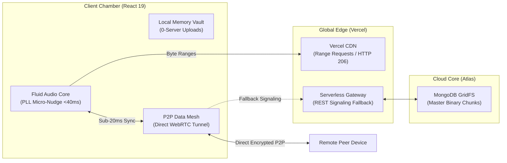

<div align="center">

# R I V E R I A
### *Where sound dissolves into memory.*

A sovereign acoustic sanctuary and zero-latency real-time listening mesh.

[](https://riveria-umber.vercel.app)
[](https://react.dev)
[](https://nodejs.org)
[](https://webrtc.org)
[](https://httpwg.org/specs/rfc9110.html)

<br />


</div>

---

### ✦ The Prologue

In an era where music applications resemble crowded spreadsheets—stuffed with behavioral trackers, algorithmically forced playlists, and endless commercial interruptions—**Riveria** was created as an act of quiet rebellion.

It is an audiophile haven for daydreamers, night-walkers, and seekers of pure resonance. Here, sound is personal, unmonetized, and sovereign:

* **Sovereign Local Vault** — Mount songs directly from your laptop or phone. They play entirely in browser memory via in-memory Object URLs. Not a single byte ever leaves your drive.
* **Telepathic WebRTC Mesh** — Step into a private Jam room with someone across the continent. When you seek or skip a song, their player moves at the exact same millisecond over direct peer-to-peer data channels.
* **Lossless Edge Streaming** — Master cloud audio streamed on-demand with HTTP `206 Partial Content` 512 KB micro-slices and cryptographic magic-byte validation.

No trackers. No algorithmic surveillance. Just the music, and the space between your thoughts.

---

### ✦ The Five Movements

Riveria’s interactive landing chamber unfolds as a scroll-driven sonic journey through five distinct aesthetic acts:

| Movement | Theme | Sonic Character | Atmosphere |
| :--- | :--- | :--- | :--- |
| **I. Overture** | Genesis | Acoustic warmth, gentle melodic resonance (*Sunflower*) | Amber dawn glow |
| **II. Philosophy** | Stillness | Delicate piano, contemplative intimacy (*Birds*) | Emerald mist |
| **III. Console** | The Instrument | Dynamic percussive bass, responsive waveform testing (*Thunder*) | Obsidian pulse |
| **IV. Architecture** | Sovereignty | Resolute engineering, zero server leaks (*Believer*) | Indigo titanium |
| **V. Reverie** | Departure | Cathartic resolution, uplifting departure (*Happier*) | Violet celestial |

*Experience the full journey with synchronized cosine-to-sine crossfades as you scroll through the chamber.*

---

### ✦ Architectural Elegance



1. **Phase-Locked Loop (PLL) Sync Engine**  
   Employs Cristian’s algorithm with RTT compensation and microsecond lookahead scheduling. If drift occurs between devices across network switches, an inaudible rate nudge ($\pm 0.015\times$) gently draws playback into phase-lock without stuttering or audio buffer resets.
2. **Private Local Audio Mounting**  
   Files are mounted into in-memory `Blob` pointers with automatic lifetime cleanup. Your personal audio library never touches a server database.
3. **Resilient Handover Mesh**  
   If a device hops between Wi-Fi and 5G cellular, Riveria automatically initiates ICE restarts and re-establishes the direct peer mesh while the audio watchdog auto-heals playback seamlessly.

---

### ✦ Symphony in Three Commands

```bash
# 1. Clone & Install
git clone https://github.com/Parth-Chavan-15/Riveria.git && cd Riveria
npm ci --prefix server && npm ci --prefix client

# 2. Configure Environment (server/.env)
# MONGODB_URI=mongodb+srv://<user>:<password>@cluster.mongodb.net/?retryWrites=true
# JWT_SECRET=your_super_secret_signing_key_32_characters_min

# 3. Launch the Sanctuary
npm run dev --prefix server   # Port 5000: Express 5 Signaling Core
npm run dev --prefix client   # Port 5173: Vite Audiophile Studio
```

*Or launch the entire production stack in an isolated Docker container:*
```bash
docker compose up --build -d
```
Access the listening haven at `http://localhost:8088`.

---

### ✦ Epilogue

> *"We do not listen to music to escape the world; we listen to remember the world we have forgotten."*

Riveria is open-source, crafted with reverence for high fidelity, uncompromising digital sovereignty, and the art of listening together in real time.

<div align="center">
<sub>Crafted with obsidian glass, lavender light, and raw acoustic passion.</sub><br />
<sub>© 2026 Riveria Music Engine.</sub>
</div>
