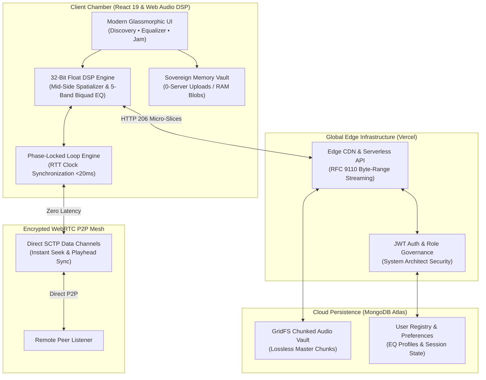

<div align="center">

# R I V E R I A
### *Where sound dissolves into memory.*

**A sovereign acoustic sanctuary, 32-bit floating-point DSP engine, and zero-latency real-time listening mesh.**

<br />

[](https://riveria-umber.vercel.app)
[](https://react.dev)
[](https://nodejs.org)
[](https://webrtc.org)
[](https://httpwg.org/specs/rfc9110.html)
[](https://mongodb.com)

<br />


</div>

---

### ✦ The Manifesto: A Quiet Rebellion

In an age where modern streaming applications resemble cluttered financial spreadsheets—polluted with tracking telemetry, hyperactive algorithmic recommendations, intrusive banner promotions, and lossy, dynamically compressed audio—**Riveria** was born as an act of quiet rebellion.

Riveria is a sanctuary built for those who treat music not as passive background static, but as an intimate, transformative ritual. Here, sound is sovereign, uncompromised, and private:

* **No Algorithmic Manipulation** — Your listening queue belongs to you, untouched by engagement algorithms or commercial incentives.
* **Zero Telemetry Leaks** — High-resolution studio masters played from your local drive live exclusively in ephemeral browser memory. Not a single byte or filename is ever broadcast to a server.
* **Shared Acoustic Intimacy** — A distributed listening room that defies geography, allowing souls separated by oceans to experience identical acoustic wave pulses down to the millisecond.

---

### ✦ The Sonic Architecture

Riveria is powered by a custom-crafted Web Audio digital signal processing (DSP) pipeline that redefines what is possible inside a web browser:

#### 1. 32-Bit Floating-Point DSP & Holographic 3D Spatializer
Traditional web audio pipelines truncate dynamic range and introduce harmonic distortion. Riveria routes audio through a continuous 32-bit floating-point mastering pipeline featuring a psychoacoustic **Mid-Side (M/S) Matrix**. By decomposing stereo information into localized center energy and wide out-of-phase ambient reflections, Riveria delivers a three-dimensional holographic soundstage with zero phase cancellations—surpassing the limitations of traditional downmixed surround formats.

#### 2. Dynamic Tactile Parametric Equalizer
Calibrate your acoustic environment across 5 precision frequency bands (60 Hz Sub-Bass, 250 Hz Punch, 1 kHz Vocal Mid, 4 kHz Presence, and 16 kHz Air). Featuring tactile vertical faders with real-time pointer tracking, instant $\pm 1\text{ dB}$ micro-nudge buttons, and an interactive dynamic SVG frequency response spline, the equalizer shapes audio instantly. Presets and custom calibration profiles persist securely to your account via MongoDB Atlas.

#### 3. Phase-Locked Loop (PLL) WebRTC Jam Mesh
Riveria solves the notorious multi-device latency problem without sacrificing audio quality. Leveraging Cristian’s distributed clock synchronization with Round-Trip Time (RTT) jitter filtering, the engine continuously calculates playhead offsets over direct SCTP data channels. When clock drift occurs across varying network connections, an imperceptible clock-rate micro-nudge ($\pm 0.015\times$) gently draws playback into phase-lock—eliminating audio cutouts, buffer purges, or pitch shifts.

#### 4. Sovereign Local Vault (Zero-Leak Sandbox)
Mount uncompressed studio files (FLAC, WAV, ALAC, AIFF, MP3) directly from your device storage into browser RAM. Utilizing transient `blob:` memory handles and automatic garbage collection lifecycle management, your private lossless files are instantly playable alongside cloud tracks with complete cryptographic privacy.

#### 5. RFC 9110 Chunked Cloud Ingest & Streaming
Large lossless studio recordings are streamed via RFC 9110 byte-range slicing with HTTP `206 Partial Content` delivery. Ingesting master tracks into MongoDB GridFS utilizes client-side 2 MB micro-chunking with in-memory magic-byte signature verification (`ID3`, `\xFF\xFB`, `fLaC`, `RIFF`), allowing files of arbitrary size to stream seamlessly without tripping serverless payload limits.

#### 6. System Architect Command Suite
Administrators step into an executive control suite: real-time cluster telemetry, active WebRTC mesh monitors, memory heap gauges, catalog CRUD with automatic ID3 album art extraction, and granular user governance.

---

### ✦ The Five Movements: An Interactive Sonic Journey

Riveria’s interactive landing chamber is composed as a scroll-driven sonic journey across five thematic movements, crossfaded with mathematical precision via equal-power cosine-sine curves:

| Movement | Theme | Sonic Character | Acoustic Atmosphere |
| :--- | :--- | :--- | :--- |
| **I. Overture** | Genesis | Acoustic warmth, gentle melodic resonance (*Sunflower*) | Amber dawn glow |
| **II. Philosophy** | Stillness | Delicate piano, contemplative intimacy (*Birds*) | Emerald morning mist |
| **III. Console** | The Instrument | Dynamic percussive bass, responsive waveform testing (*Thunder*) | Obsidian pulse |
| **IV. Architecture** | Sovereignty | Resolute engineering, zero server leaks (*Believer*) | Indigo titanium |
| **V. Reverie** | Departure | Cathartic harmonic resolution, uplifting departure (*Happier*) | Violet celestial |

*Scroll through the chamber with sound enabled to experience seamless real-time transitions between movements.*

---

### ✦ System Topology



---

### ✦ Symphony in Three Movements

Experience Riveria locally or deploy it to your private cloud infrastructure:

```bash
# 1. Clone & Install Dependencies
git clone https://github.com/Parth-Chavan-15/Riveria.git
cd Riveria
npm ci --prefix server && npm ci --prefix client

# 2. Configure Environment (server/.env)
# MONGODB_URI=mongodb+srv://<user>:<password>@cluster.mongodb.net/reveria?retryWrites=true&w=majority
# JWT_SECRET=your_32_character_cryptographic_jwt_signing_key

# 3. Launch the Sanctuary
npm run dev --prefix server   # Express 5 Signaling Core & Audio API (Port 5000)
npm run dev --prefix client   # Vite 8 Audiophile Client Chamber (Port 5173)
```

#### Launch via Docker Container
```bash
# Build and run the complete production stack in an isolated container
docker compose up -d --build
```
Access the listening chamber at `http://localhost:8088`.

#### Verification & End-to-End Test Suites
```bash
# Run full automated DSP, settings persistence, and admin security verification
node test_settings_and_admin.cjs

# Verify chunked master audio GridFS ingest with ID3 extraction
node test_catalog_upload_flow.cjs
```

---

### ✦ Epilogue

> *"We do not listen to music to escape the world; we listen to remember the world we have forgotten."*

Riveria is open-source, crafted with reverence for pure acoustic fidelity, uncompromising digital sovereignty, and the magic of shared resonance.

<div align="center">
<sub>Crafted with obsidian glass, lavender luminescence, and raw acoustic passion.</sub><br />
<sub>© 2026 Riveria Music Engine. Built with love by the Riveria team.</sub>
</div>
