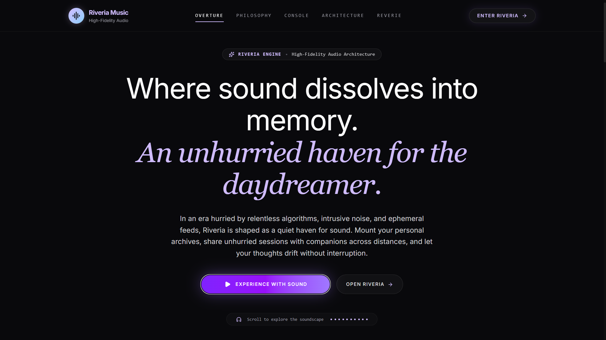
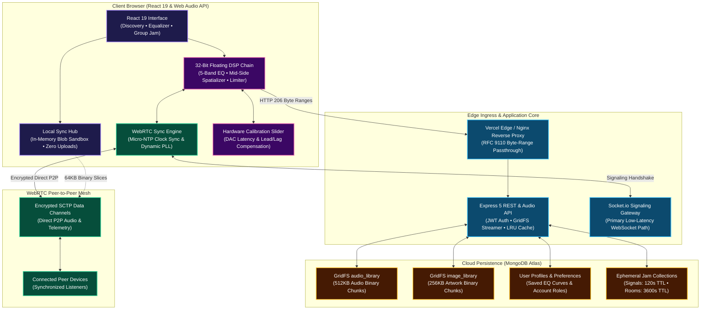

<div align="center">

# Riveria Music Engine

**An audiophile web streaming platform featuring real-time WebRTC synchronized group playback, browser-native 32-bit floating-point studio mastering, and private in-memory local audio streaming.**

<br />

[](https://riveria-umber.vercel.app)
[](https://react.dev)
[](https://nodejs.org)
[](https://developer.mozilla.org/en-US/docs/Web/API/Web_Audio_API)
[](https://webrtc.org)
[](https://httpwg.org/specs/rfc9110.html)
[](https://mongodb.com)

<br />

<a href="https://riveria-umber.vercel.app">
  
</a>

</div>

---

## Overview

Most mainstream streaming platforms compress audio into lossy formats, enforce algorithmic recommendation clutter, and suffer from noticeable playback delays when multiple devices try to play together in the same room.

**Riveria** is a modern full-stack music engine engineered from the ground up to solve these problems:

1. **High-Fidelity Cloud Streaming:** Streams lossless audio files (FLAC, MP3, WAV) on demand via RFC 9110 HTTP Range requests with an in-memory chunk cache for instant, zero-delay scrubbing.
2. **Sub-Millisecond Synced Listening (WebRTC Jam):** Allows multiple listeners on different devices to listen to the exact same audio stream in tight acoustic synchronization (< 4 ms) using peer-to-peer data channels and a custom Phase-Locked Loop (PLL) engine.
3. **Studio-Grade DSP Equalizer:** Operates a browser-native 32-bit floating-point Web Audio API mastering chain with a 5-band parametric equalizer, Mid-Side 3D spatializer, dynamic volume normalizer, and real-time FFT spectrum visualizer.
4. **Zero-Server-Upload Local Vault:** Mounts personal audio files straight into browser memory via Blob URLs. Songs play entirely inside client RAM with zero server uploads and can be streamed peer-to-peer to friends over encrypted WebRTC channels.
5. **Architect Control Room:** Gives administrators a full management suite for uploading cloud tracks, inspecting real-time system telemetry, and governing user permissions.

---

## Core Features

### 1. High-Fidelity Cloud Streaming (RFC 9110 & GridFS)
* **Byte-Range Audio Delivery:** Uses RFC 9110 HTTP 206 Partial Content range requests (`bytes=start-end`) to stream audio in discrete chunks.
* **Instant Scrubbing:** Jump anywhere in a song with zero rebuffering lag, backed by an in-memory LRU audio cache delivering sub-5 ms initial chunk response times.
* **Dual-Bucket Storage:** Audio files are partitioned into 512 KB chunks in MongoDB GridFS (`audio_library`), while artwork is stored in 256 KB chunks (`image_library`) to ensure low database latency.
* **Magic-Byte Security:** Every uploaded track is inspected at the binary header level (`ID3`/`0xFF 0xFB` for MP3, `fLaC` for FLAC, `RIFF` for WAV) before storage, preventing malicious or corrupted files.

### 2. 32-Bit Web Audio API Studio Mastering Chain
* **5-Band Parametric Equalizer:** Control audio frequencies with high-precision faders:
  * **60 Hz (Sub-Bass):** Low-shelf filter for deep low-end rumble and bass fullness.
  * **250 Hz (Punch / Low-Mid):** Peaking filter for drum punch and warmth.
  * **1 kHz (Vocal Midrange):** Peaking filter for vocal clarity and instrument presence.
  * **4 kHz (Presence / Treble):** High-shelf filter for crisp articulation and attack.
  * **16 kHz (Air):** High-shelf filter for ultra-high harmonic sparkle.
* **Curated Studio Presets:** Switch instantly between *Studio Reference (Flat)*, *Bass Presence (+6dB)*, *Vocal Radiance*, *Electronic & Club*, and *Acoustic Warmth*.
* **Dynamic Response Curve:** An interactive SVG curve updates in real time to visually depict the frequency gain modifications across all five bands.
* **Mid-Side 3D Holographic Spatializer:** Deconstructs the stereo soundstage into Mid and Side signals using an 18 ms Haas matrix delay, creating an expansive spatial field without mono phase cancellation.
* **Dynamic Normalizer & Peak Limiter:** Built-in `DynamicsCompressorNode` (-24 dB threshold, 4:1 ratio) prevents clipping and normalizes volume between loud and quiet tracks.
* **2048-Bin FFT Spectrum Visualizer:** Real-time frequency analysis rendered to smooth UI waveform monitors.
* **Cloud Preference Persistence:** Equalizer curves and audio preferences automatically save to your account in MongoDB and sync across all your devices.

### 3. WebRTC Listening Jam (Real-Time Synchronized Playback)
* **Direct Peer-to-Peer Mesh:** Connect with friends using 6-character room codes. Connected devices form direct, encrypted SCTP DataChannel links (`jam_sync`), bypassing media relays.
* **Bidirectional 4-Timestamp Micro-NTP:** Continuously calculates network Round-Trip Time (RTT) and clock offset ($\theta$) between the host and listener devices, filtering out high-jitter network spikes.
* **Three-Zone Dynamic Phase-Locked Loop (PLL):**
  * **Zone 0 ($\le 4\text{ ms}$):** Bit-perfect phase lock. Zero adjustments required.
  * **Zone 1 ($4\text{ ms} < \Delta \le 45\text{ ms}$):** Dynamic micro-slew rate modulation ($0.985\times - 1.015\times$) that smoothly guides playback back into phase without clicks or audible pitch warble.
  * **Zone 2 ($> 45\text{ ms}$):** Instant phase snap directly aligning `currentTime` to the host anchor.
* **Audio Buffering Catch-Up:** Uses the native `onPlaying` browser event to detect OS audio decoder startup delay, guaranteeing that playback timers only begin when physical sound leaves the DAC.
* **Dual-Path Signaling with Auto-Failover:** Real-time Socket.io WebSockets are used for low-latency handshakes, backed by an automatic HTTP REST polling fallback using MongoDB TTL collections (`jam_signals` expires in 120s; `jam_rooms` expires in 3600s) to reliably traverse strict corporate firewalls.

### 4. Acoustic Phase Alignment & Hardware Calibration
* **Speaker Distance & DAC Compensation:** In-room multi-device playback can create destructive comb filtering when physical devices have different internal audio buffer delays.
* **Calibration Slider:** Allows listeners to set custom lead/lag compensation offsets ($\Delta_{hw}$ from -60 ms to +60 ms).
* **Built-in Presets:**
  * **Studio Reference (0 ms):** Direct low-latency line-out and desktop drivers.
  * **Android AudioTrack (-25 ms):** Compensates for mobile OS mixer buffer latency.
  * **Cellular Network (-40 ms):** Compensates for mobile carrier transit jitter.

### 5. Local Sync Hub (Zero-Server-Upload Privacy)
* **In-Memory Memory Sandboxing:** Drag and drop local audio files (MP3, FLAC, WAV) directly into the app. They mount as in-memory Blob URLs (`URL.createObjectURL`).
* **Absolute Privacy:** Audio bytes live strictly inside the browser's volatile RAM. Zero bytes are ever uploaded, saved, or logged to the backend server.
* **P2P Local Track Sharing:** Play local tracks in a WebRTC Jam session by automatically slicing the memory blob into 64 KB binary packets and streaming them directly over encrypted peer data channels to friends.
* **Optional Cloud Ingest:** System administrators can promote any local track to the permanent cloud catalog with a single click.

### 6. System Architect Command Suite (Admin Control)
* **Role-Based Access Control (RBAC):** Clean security boundary separating standard `listener` accounts from administrative `admin` accounts.
* **Master Catalog Management:** Upload new cloud audio tracks with automatic extraction of embedded ID3 metadata (title, artist, duration) and album artwork, edit track information, and delete assets.
* **Engine Console Telemetry:** Real-time dashboard showing active WebRTC meshes, memory heap allocations, server uptime, and streaming load.
* **User Governance:** Inspect registered accounts and promote or demote user permissions in real time.

### 7. Multi-Account & Multi-Tab Isolation
* **Independent Sessions on One Device:** Prioritizes `sessionStorage` over `localStorage` combined with an ephemeral tab nonce (`tabId`).
* **Concurrent Testing:** An administrator and a listener account can run simultaneously in two separate tabs of the same browser window without session crosstalk or WebRTC peer ID collisions.

---

## System Architecture

<details>
<summary><b>✦ Click here to expand the System Architecture Diagram</b></summary>
<br />



</details>

---

## Technology Stack

| Layer | Technology | Version | Purpose |
| :--- | :--- | :--- | :--- |
| **Frontend SPA** | React | 19.x | Reactive UI, hooks, Concurrent Mode for non-blocking audio scheduling |
| **Bundler / Build**| Vite (Rollup) | 8.x | ES module bundling, instant Hot Module Replacement (HMR) |
| **Styling** | Tailwind CSS & Framer Motion | 4.x / 14.x | Dark obsidian theme, fluid animations, responsive layouts |
| **Audio Processing**| Web Audio API | Standard | 32-bit floating-point mastering chain, 5-band EQ, Mid-Side spatializer |
| **P2P Transport** | WebRTC DataChannels | Standard | Direct peer-to-peer binary mesh and micro-NTP synchronization |
| **Realtime Gateway**| Socket.io | 4.8.x | Low-latency WebRTC signaling and mesh room management |
| **Backend Runtime** | Node.js (Alpine Linux) | 22.x LTS | High-throughput asynchronous event loop and stream piping |
| **Web Framework** | Express.js | 5.2.x | REST API routing, RFC 9110 range streaming, security middleware |
| **Database** | MongoDB Atlas & GridFS | 9.x | Document storage and dual-bucket chunked audio/image persistence |
| **Object Modeling** | Mongoose | 9.x | Strict schema validation, lifecycle hooks, and TTL indexes |
| **Validation** | Zod | 4.x | Compile-time and runtime input schema validation |
| **Security** | Helmet & Bcrypt.js | 8.x / 3.x | HTTP security headers, CORS protection, salted password hashing |
| **Reverse Proxy** | Nginx | 1.27 Alpine | Unbuffered byte-range streaming proxy and WebSocket routing |
| **Containers** | Docker & Docker Compose | v2 | Multi-stage lightweight Alpine container deployment |

---

## Project Structure

```text
Riveria/
├── client/                     # Frontend React 19 single-page application
│   ├── public/                 # Static assets, favicon, audio files, preview images
│   ├── src/
│   │   ├── components/         # Modular UI components (Navbar, Player, Visualizer)
│   │   ├── context/            # Global contexts (AuthContext, PlayerContext, JamContext)
│   │   ├── hooks/              # Custom hooks for audio playback and WebRTC
│   │   ├── pages/              # Primary views (Dashboard, Settings, JamSession, Admin)
│   │   └── services/           # API request layer and catalog uploader
│   └── package.json
├── server/                     # Backend Node.js Express 5 API
│   ├── controllers/            # Route controllers (Auth, Track, Jam, Admin)
│   ├── middleware/             # Security, JWT auth, and role verification
│   ├── models/                 # Mongoose schemas (User, Track, JamRoom, JamSignal)
│   ├── routes/                 # Express REST endpoint declarations
│   ├── services/               # GridFS storage engine, LRU cache, audio validator
│   └── server.js               # Application bootstrap and Socket.io gateway
├── docs/
│   └── images/                 # High-resolution documentation preview screenshots
├── docker-compose.yml          # Production multi-container composition
├── vercel.json                 # Edge serverless configuration and rewrites
└── README.md                   # System documentation
```

---

## Quickstart & Local Setup

### Prerequisites
* **Node.js:** `v20.x` or `v22.x LTS` installed
* **npm:** `v10.x` or higher
* **MongoDB:** A local MongoDB instance or a free MongoDB Atlas connection string

### 1. Clone the Repository
```bash
git clone https://github.com/Parth-Chavan-15/Riveria.git
cd Riveria
```

### 2. Install Dependencies
```bash
npm ci --prefix server
npm ci --prefix client
```

### 3. Configure Environment Variables
Create a `.env` file in the `server` directory (refer to `.env.example`):
```env
PORT=5000
NODE_ENV=development
MONGODB_URI=mongodb+srv://<username>:<password>@cluster0.mongodb.net/riveria?retryWrites=true&w=majority
JWT_SECRET=your_32_character_cryptographic_jwt_secret_key
CLIENT_ORIGIN=http://localhost:5173
```

### 4. Launch Development Servers
Run both backend and frontend concurrently:
```bash
# Terminal 1: Backend Server (Port 5000)
npm run dev --prefix server

# Terminal 2: Frontend Studio (Port 5173)
npm run dev --prefix client
```
Open **`http://localhost:5173`** in your browser. The Vite development proxy forwards all `/api` and Socket.io calls directly to port 5000.

---

## Containerized Deployment (Docker Compose)

To launch the complete application stack in isolated production containers with Nginx reverse proxying:

```bash
# Build and launch all services in detached mode
docker compose up -d --build
```

* **Frontend & Reverse Proxy:** Accessible at **`http://localhost:8088`**
* **Audio Persistence:** Uploaded tracks persist across restarts via the named Docker volume `audio_uploads`.
* **Healthchecks:** Built-in probes automatically monitor service health and handle automatic restart if needed.

---

## Testing & Verification Suites

Riveria includes automated test and quality suites covering backend logic, file security, and frontend compilation:

```bash
# Run backend unit tests (native Node.js test runner)
npm test --prefix server

# Run frontend quality checks (oxlint)
npm run lint --prefix client

# Verify frontend production build (Vite & Rolldown)
npm run build --prefix client

# Run automated settings persistence and admin security test
node test_settings_and_admin.cjs

# Run automated master audio upload and GridFS ingest test
node test_catalog_upload_flow.cjs
```

---

## API Reference Summary

| Method | Endpoint | Access | Purpose |
| :--- | :--- | :--- | :--- |
| `POST` | `/api/auth/register` | Public | Register a new listener account |
| `POST` | `/api/auth/login` | Public | Authenticate credentials and receive JWT |
| `GET` | `/api/auth/me` | Authenticated | Retrieve authenticated user profile and saved audio preferences |
| `PUT` | `/api/auth/preferences` | Authenticated | Persist custom 5-band EQ curve and audio buffer settings |
| `GET` | `/api/tracks` | Public | Fetch all available cloud library tracks |
| `GET` | `/api/tracks/:id` | Public | Fetch single track metadata |
| `GET` | `/api/tracks/:id/stream`| Public | Stream audio using RFC 9110 byte-range slicing |
| `POST` | `/api/tracks/upload` | Admin Only | Upload audio binary to GridFS with magic-byte validation |
| `POST` | `/api/tracks` | Admin Only | Register track metadata and cover image in the database |
| `PUT` | `/api/tracks/:id` | Admin Only | Update existing track details |
| `DELETE`| `/api/tracks/:id` | Admin Only | Remove track and delete associated GridFS binary chunks |
| `POST` | `/api/jam/room` | Authenticated | Create a new WebRTC listening room |
| `GET` | `/api/jam/room/:code` | Authenticated | Fetch room status and active peer roster |
| `POST` | `/api/jam/signal` | Authenticated | Dispatch WebRTC signaling offer, answer, or ICE candidate |
| `GET` | `/api/jam/signals/:code`| Authenticated | Poll pending signals (fallback when WebSockets are blocked) |
| `GET` | `/api/admin/users` | Admin Only | List all registered user accounts |
| `PUT` | `/api/admin/users/:id/role`| Admin Only | Promote or demote user account role (`listener` / `admin`) |
| `GET` | `/api/admin/telemetry` | Admin Only | Inspect server memory heap and active WebRTC mesh count |

---

## License

Riveria is open-source software licensed under the **MIT License**.

<div align="center">
<sub>© 2026 Riveria Music Engine. Built with passion for high-fidelity sound, digital privacy, and shared listening.</sub>
</div>
