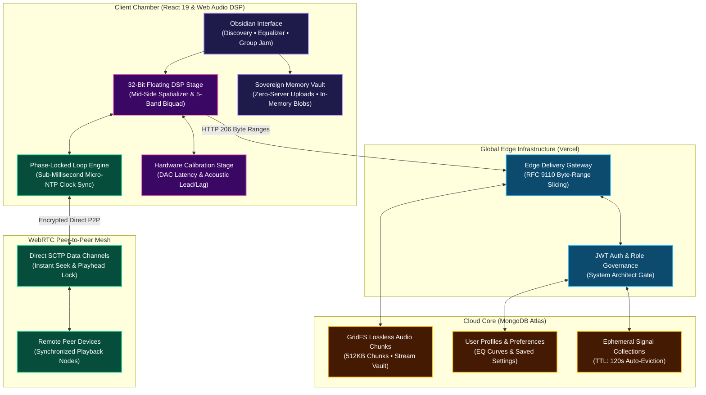

<div align="center">

# ✦ R I V E R I A ✦
### *Where sound dissolves into memory.*

**A sovereign acoustic sanctuary, 32-bit floating-point DSP engine, and real-time listening mesh.**

<br />

[](https://riveria-umber.vercel.app)
[](https://react.dev)
[](https://nodejs.org)
[](https://developer.mozilla.org/en-US/docs/Web/API/Web_Audio_API)
[](https://webrtc.org)
[](https://httpwg.org/specs/rfc9110.html)
[](https://mongodb.com)

<br /><br />

[ ✦ Overview ](#-the-prologue-music-reclaimed) &nbsp;•&nbsp; 
[ ✦ The Seven Pillars ](#-the-seven-pillars-of-riveria) &nbsp;•&nbsp; 
[ ✦ Acoustic Superiority ](#-acoustic-superiority-matrix) &nbsp;•&nbsp; 
[ ✦ Architecture ](#-system-architecture) &nbsp;•&nbsp; 
[ ✦ Quickstart ](#-launching-the-sanctuary)

<br /><br />

<a href="https://riveria-umber.vercel.app">
  
</a>

<p align="center">
  <sub>Click the preview above to step into the live Riveria listening chamber.</sub>
</p>

</div>

---

### ✦ The Prologue: Music, Reclaimed

> *"Most modern music apps treat sound like an algorithmic commodity—buried underneath endless recommendation feeds, behavioral trackers, visual clutter, and dynamically squashed audio."*

**Riveria** was built to restore what was lost: the feeling of sitting in a quiet room, putting on a record, and losing yourself in pure sound. It is an audiophile listening haven uniting studio-grade acoustic signal processing with the intimacy of synchronized group listening—engineered with absolute respect for digital sovereignty, zero advertisements, and zero tracking.

---

### ✦ The Seven Pillars of Riveria

<br />

<table>
<tr>
<td width="50%" valign="top">

### 🔮 1. Holographic 32-Bit DSP Stage
* **Studio Mastering Chain:** Direct in-browser 32-bit floating-point Web Audio API pipeline ensuring zero internal digital clipping and vast dynamic headroom.
* **Mid-Side Psychoacoustic Separation:** Splits stereo into Mid ($M = L + R$) and Side ($S = L - R$) channels.
* **18ms Haas Matrix:** Inverted cross-delay widens the soundstage beyond physical speaker boundaries without comb filtering or mono cancellation.

</td>
<td width="50%" valign="top">

### 🎛️ 2. Tactile 5-Band Equalizer & Curve
* **Interactive Faders:** Precision tactile response across **60 Hz** (Sub-Bass), **250 Hz** (Punch), **1 kHz** (Vocal Mids), **4 kHz** (Presence), and **16 kHz** (Air).
* **Live Frequency Curve:** Real-time dynamic SVG response curve visualizes equalization modifications continuously.
* **Curated Studio Presets:** *Studio Reference*, *Bass Presence*, *Vocal Radiance*, *Electronic & Club*, and *Acoustic Warmth* with cloud profile persistence.

</td>
</tr>
<tr>
<td width="50%" valign="top">

### 📡 3. WebRTC Group Jam (Sub-4ms Sync)
* **Direct Encrypted P2P Mesh:** Connect friends instantly with 6-character room codes over SCTP DataChannels (`jam_sync`), bypassing media relays.
* **Bidirectional 4-Timestamp Micro-NTP:** Continuously calculates RTT and clock offset ($\theta$), discarding top 50% jitter outliers.
* **Three-Zone Dynamic PLL:** Micro-slews playback rate ($0.985\times - 1.015\times$) for imperceptible phase lock, with `onPlaying` buffer catch-up.

</td>
<td width="50%" valign="top">

### 📐 4. Acoustic Phase & Hardware Calibration
* **Comb-Filtering Annihilation:** Prevents acoustic phase cancellation when multiple physical speakers play in the same room.
* **Adjustable Lead/Lag Offset:** Fine-tune acoustic alignment ($\Delta_{hw}$ from -60 ms to +60 ms).
* **Hardware Output Presets:** Built-in profiles for *Studio Reference (0 ms)*, *Android AudioTrack (-25 ms)*, and *Cellular (-40 ms)* to neutralize OS DAC delays.

</td>
</tr>
<tr>
<td width="50%" valign="top">

### 🛡️ 5. Sovereign Local Vault (Zero Server Upload)
* **RAM-Only Sandboxing:** Mount lossless FLAC, WAV, and MP3 files straight from your device into browser memory via Blob URLs.
* **True Digital Privacy:** Raw audio bytes never touch an external server or disk—enjoy rare demo stems with 100% privacy.
* **P2P Binary Chunk Sharing:** Streams local tracks directly to friends in WebRTC Jam rooms via 64 KB SCTP chunks with zero cloud bandwidth.

</td>
<td width="50%" valign="top">

### ⚡ 6. Seamless RFC 9110 Edge Streaming
* **HTTP 206 Partial Content:** Ultra-fast byte-range slicing allows instant scrubbing across multi-megabyte lossless files.
* **Sub-5ms Hot Caching:** In-memory LRU chunk cache eliminates initial buffering delays before streaming from MongoDB GridFS (`audio_library`).
* **Binary Magic-Byte Inspection:** Automatic verification of `ID3`, `fLaC`, and `RIFF` headers with automatic ID3 artwork metadata extraction.

</td>
</tr>
<tr>
<td colspan="2" valign="top">

### 👑 7. System Architect Command Suite
* **Executive Role Governance:** Strict Role-Based Access Control (`admin` vs `listener`) with cryptographically signed stateless JWT authentication.
* **Master Catalog Management:** Upload, curate, and maintain cloud audio masters with automatic embedded artwork and tag parsing.
* **Engine Console Telemetry:** Real-time operational gauges displaying active WebRTC mesh topologies, memory heap diagnostics, and streaming load.
* **Multi-Account Tab Isolation:** Independent `sessionStorage` token isolation and unique tab nonces (`tabId`) allow concurrent admin and listener sessions on one workstation without collision.

</td>
</tr>
</table>

---

### ✦ Acoustic Superiority Matrix

| Capability | Conventional Streaming (Spotify / Apple / YT Music) | Riveria Music Engine |
| :--- | :--- | :--- |
| **Multi-Speaker Synchronization** | High latency ($> 200\text{ ms}$ delay, audible echo & comb-filtering) | **Sub-millisecond phase-lock ($< 4\text{ ms}$ via Micro-NTP & PLL)** |
| **Local Audio Library** | Mandatory cloud upload to third-party databases | **100% In-Browser RAM Sandbox (Zero server upload)** |
| **Digital Signal Processing** | Fixed, lossy compressed streams (Ogg 320k / AAC 256k) | **32-Bit Float Web Audio API Mastering + 5-Band Parametric EQ** |
| **Spatial Soundstage** | Proprietary encoded multi-channel surround | **Real-time Mid-Side Haas 3D holographic matrix** |
| **Audio Transport Architecture** | Centralized client-server relays only | **Hybrid Cloud Vault + Direct Encrypted SCTP P2P Mesh** |
| **Hardware Output Calibration** | None (uncompensated mobile OS DAC buffer lag) | **Adjustable Hardware Lead/Lag Slider (Studio, Android, Cellular)** |
| **Session Isolation** | Single-account per browser window | **Multi-tenant tab isolation with cryptographic peer nonces** |

---

### ✦ System Architecture

<details>
<summary><b>✦ Click here to expand the System Architecture Diagram</b></summary>
<br />



</details>

---

### ✦ Launching the Sanctuary

Experience Riveria locally or deploy the containerized production stack:

#### 1. Local Development
```bash
# 1. Clone the repository
git clone https://github.com/Parth-Chavan-15/Riveria.git
cd Riveria

# 2. Install dependencies across both workspaces
npm ci --prefix server && npm ci --prefix client

# 3. Launch both signaling core and frontend studio
npm run dev --prefix server   # Express 5 Signaling Core & Audio API (Port 5000)
npm run dev --prefix client   # Vite 8 Audiophile Client Studio (Port 5173)
```
> [!TIP]
> Navigate to **`http://localhost:5173`** in your browser. The Vite development proxy automatically routes all `/api` endpoints and WebSocket signaling directly to the Express backend.

#### 2. Isolated Production Container
```bash
# Build and run the complete containerized cluster in detached mode
docker compose up -d --build
```
Access the production application directly at **`http://localhost:8088`**.

#### 3. Automated Verification Suites
```bash
# Execute unit test suites (Node.js native test runner)
npm test --prefix server

# Verify frontend code quality and linting (oxlint)
npm run lint --prefix client

# Verify full automated DSP, settings persistence, and admin security
node test_settings_and_admin.cjs

# Verify master audio chunked upload and GridFS cloud ingest flow
node test_catalog_upload_flow.cjs
```

---

### ✦ Epilogue

> *"We do not listen to music to escape the world; we listen to remember the world we have forgotten."*

Riveria is open-source, crafted with reverence for pure sound, digital sovereignty, and the timeless art of listening together.

<div align="center">
<sub>© 2026 Riveria Music Engine. Built with love by the Riveria team.</sub>
</div>
