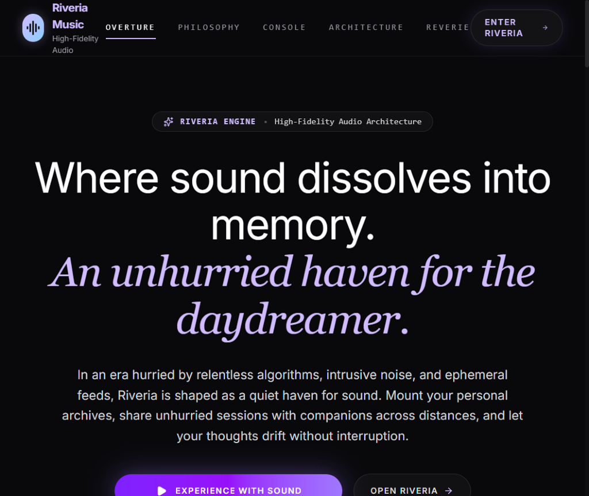
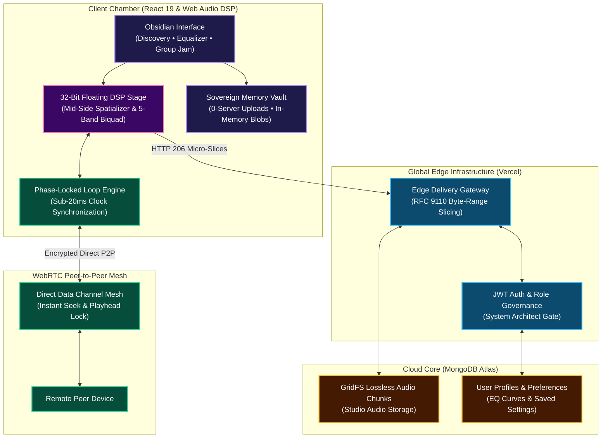

<div align="center">

# R I V E R I A
### *Where sound dissolves into memory.*

**A sovereign acoustic sanctuary, 32-bit floating-point DSP engine, and real-time listening mesh.**

<br />

[](https://riveria-umber.vercel.app)
[](https://react.dev)
[](https://nodejs.org)
[](https://webrtc.org)
[](https://httpwg.org/specs/rfc9110.html)
[](https://mongodb.com)

<br />



</div>

---

### ✦ The Prologue: Music, Reclaimed

Most modern music apps treat sound like an algorithmic commodity—buried underneath endless recommendation feeds, behavioral trackers, visual clutter, and dynamically squashed audio.

**Riveria** was built to restore what was lost: the feeling of sitting in a quiet room, putting on a record, and losing yourself in pure sound. It is a sovereign listening haven that combines studio-grade acoustic processing with the warmth of shared listening—free from advertisements, tracking, or commercial algorithms.

---

### ✦ What You Can Experience in Riveria

Whether you are seeking solace in late-night listening or syncing a song with a friend across the world, Riveria is designed to feel effortless, intimate, and alive:

#### 1. Holographic 32-Bit Floating DSP Stage
Hear your music the way master recording engineers intended. Riveria runs a high-resolution 32-bit floating-point audio engine with a **Holographic 3D Spatializer**. Using psychoacoustic Mid-Side separation, it expands the acoustic soundstage beyond flat stereo into a wide, immersive chamber—delivering clarity and warmth without the phase distortion of traditional virtual surround.

#### 2. Tactile 5-Band Equalizer & Dynamic Curve
Shape your sound with tactile, responsive vertical faders that react to your touch. Watch the dynamic frequency response curve sculpt itself in real time as you adjust Sub-Bass, Punch, Vocal Mids, Presence, and Air. Switch between curated studio profiles (*Bass Presence*, *Vocal Radiance*, *Acoustic Warmth*) or carve your own signature tone. Every preference is automatically saved to your cloud account so your acoustic profile stays with you across all your devices.

#### 3. WebRTC Group Jam — Listen Together in Real Time
Music was never meant to be experienced alone. Riveria lets you spin up a private WebRTC Listening Jam and invite friends with a single link. Over direct encrypted peer-to-peer data channels, playback stays in telepathic sync: when you pause, scrub to a bridge, or change a track, every connected device moves at the exact same millisecond—with no server in the middle delaying the sound.

#### 4. Sovereign Local Vault (Zero Server Uploads)
Your private collection of lossless FLACs, WAVs, or rare MP3s stays truly private. Mount local audio files directly from your computer or phone. They play entirely inside browser memory via ephemeral pointers. Zero bytes ever leave your device, meaning you can enjoy your rarest tracks inside Riveria's audiophile pipeline with absolute privacy.

#### 5. Seamless Edge Streaming & Studio Ingest
Cloud tracks stream with instant, zero-buffering scrubbing via RFC 9110 byte-range slicing. When new studio masters are introduced, Riveria’s chunked ingest processes high-resolution audio into MongoDB GridFS while automatically extracting embedded ID3 cover art and track metadata.

#### 6. System Architect Command Suite
For administrators, Riveria provides an executive control room: real-time telemetry gauges showing active WebRTC meshes, memory heap diagnostics, live catalog curation, and user role management.

---

### ✦ System Architecture

<details>
<summary><b>✦ Click here to view the System Architecture Diagram</b></summary>
<br />



</details>

---

### ✦ Launching Riveria

Experience the sanctuary locally or deploy the complete stack:

#### 1. Local Development
```bash
# Clone the repository
git clone https://github.com/Parth-Chavan-15/Riveria.git
cd Riveria

# Install dependencies
npm ci --prefix server && npm ci --prefix client

# Launch both signaling server and frontend studio
npm run dev --prefix server   # Port 5000: Express 5 Signaling Core
npm run dev --prefix client   # Port 5173: Vite Audiophile Client
```

#### 2. Isolated Production Container
```bash
# Build and run the complete containerized stack with one command
docker compose up -d --build
```
Open `http://localhost:8088` in your browser.

#### 3. Automated Verification Suites
```bash
# Run full automated DSP, settings persistence, and admin security tests
node test_settings_and_admin.cjs

# Verify master audio chunked upload and GridFS cloud ingest flow
node test_catalog_upload_flow.cjs
```

---

### ✦ Epilogue

> *"We do not listen to music to escape the world; we listen to remember the world we have forgotten."*

Riveria is open-source, crafted with reverence for pure sound, digital sovereignty, and the timeless art of listening together.

<div align="center">
<sub>© 2026 Riveria Music Engine. Built with love by the Riveria team.</sub>
</div>
