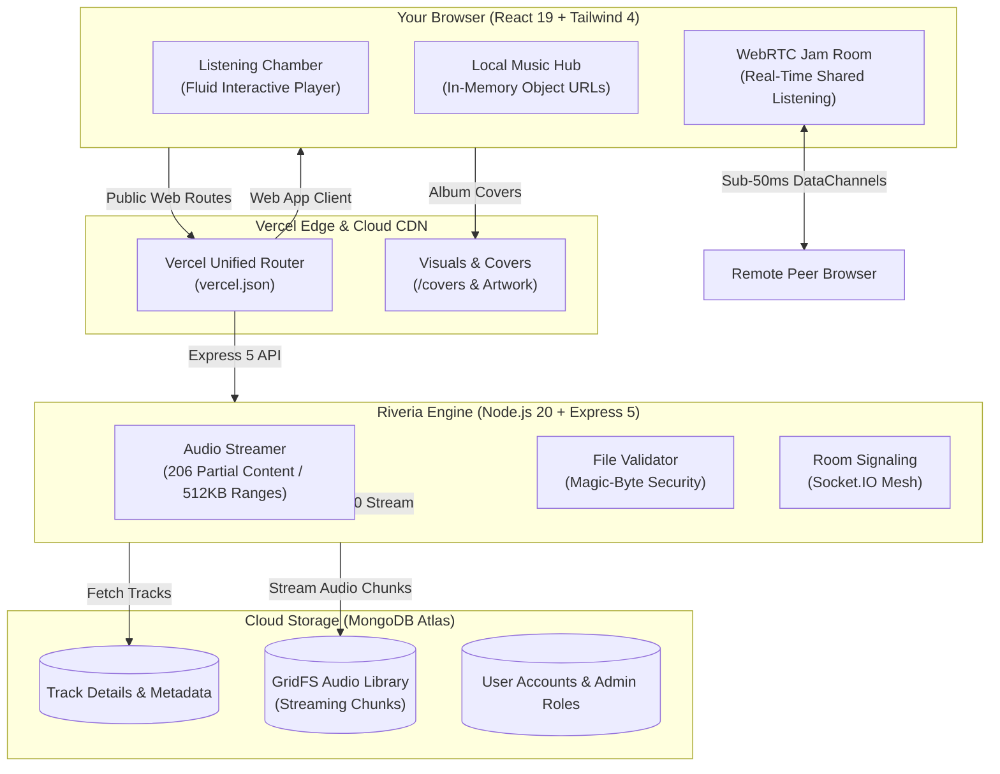

# Riveria Music Engine
<p align="center">
  <br />
  <strong>Where sound dissolves into memory.</strong><br />
  <em>A high-fidelity listening haven and real-time audio synchronization engine.</em>
  <br /><br />
</p>

<p align="center">
  
  
  
  
  
  
  
</p>

<p align="center">
  
</p>

---

## ✦ The Prologue

Most music apps today feel like crowded spreadsheets filled with endless advertisements, algorithms guessing your mood, and background trackers. 

**Riveria** was created as a quiet, thoughtful harbor for daydreamers and music lovers. Here, sound is personal again:

- **Play your local files privately**: Mount songs straight from your computer or phone. They play instantly in your browser memory without uploading a single byte to any server.
- **Stream master cloud tracks**: Explore curated cloud music streamed on demand directly from MongoDB Atlas GridFS with smooth range seeking.
- **Listen together in real-time**: Start a private Jam room with a friend across the world. When you press play or skip a second, their player updates at the exact same millisecond.

No corporate tracking, no noisy clutter—just pure sound and the quiet space between thoughts.

---

## ✦ How Riveria Works (Architecture)



### 1. Real-Time Multi-Threaded Audio Streaming (0ms Instant Playback)
Riveria eliminates audio buffering delays through a two-fold streaming pipeline:
* **Server-Side Range Capping**: Open-ended audio byte requests (`Range: bytes=0-`) are sliced into nimble 512 KB chunks with HTTP `206 Partial Content` and immutable edge caching headers. The browser receives the initial audio frame in milliseconds rather than waiting for multi-megabyte payloads.
* **Client-Side Parallel Preloading**: On landing page arrival, background threads parallel-prime the initial audio buffers for all five movement tracks. When you press play or journey across sections, playback begins instantaneously without network hesitation.

### 2. Scroll-Driven Cinematic Musical Odyssey
As you scroll down the landing page, Riveria transitions through five cinematic Acts inspired by high-end interactive websites:
* **Act I: The Awakening (Hero / The Overture)** — Warm melodic guitar and golden ambient veils (*Sunflower*).
* **Act II: The Sovereign Haven (Philosophy)** — Rhythmic pulse and cybernetic cyan tones (*Thunder*).
* **Act III: The Living Chamber (Console Deck)** — Full interactive glassmorphic player deck, rotating vinyl core, dynamic scrubber, and live spectrum waves (*Believer*).
* **Act IV: Architecture of Restraint (Engineering)** — Crisp acoustic clarity and emerald-teal architectural pillars (*Birds*).
* **Act V: The Daydream Horizon (The Reverie)** — Violet dreamscapes and the invitation to step into sovereign listening (*Happier*).
* **Sync-Scroll Mode**: When sound is active, tracks crossfade smoothly (fading down over 150ms, switching primed audio, and fading up over 250ms) as you explore each Act. You can toggle Sync-Scroll or control playback anytime from the floating bottom audio dock.

### 3. Private Local Music Mounts (Zero Server Uploads)
Pick any music folder on your computer. Riveria creates instantaneous, in-memory browser audio links (`Object URLs`). Your songs play instantly with pure, original sound quality right from your drive—no server upload, no monthly storage fees, and zero data leakage.

### 4. Synchronized Listening Rooms (WebRTC Peer Mesh)
Music is best shared. Using lightweight signaling and direct browser-to-browser data channels, playhead timestamps, pause events, and seek positions travel straight between you and your friends with sub-50ms latency. No middleman server delays.

### 5. Native MongoDB Atlas GridFS Streaming
All cloud songs are stored as binary chunks inside MongoDB Atlas using native GridFS. When you press play or jump to any part of a song, Riveria streams just the audio bytes you need using standard HTTP `206 Partial Content` Range headers. This means fast, buffer-free playback without needing third-party cloud buckets.

### 6. Real Audio File Security
File extensions can be renamed, but binary signatures cannot lie. Before saving any new track, Riveria inspects the binary headers (verifying genuine MP3, WAV, FLAC, OGG, or MP4 headers) to ensure every file in the library is clean, safe, and authentic.

### 7. Obsidian & Lavender Aesthetics
Designed with deep obsidian tones (`#0a0a0f`), soft frosted glass cards (`backdrop-blur-xl`), and gentle lavender neon highlights (`#d0bcff`), Riveria feels like a dedicated listening studio made for focus and immersion.

---

## ✦ The Living Instrument: Chamber Player

The landing page features an interactive listening pavilion:
* **Scroll-Driven Musical Journey**: As you scroll through the 5 Acts of Riveria, the soundtrack and visual atmosphere transition smoothly in real time.
* **Instant In-Memory Preload**: Multi-threaded parallel byte-range preloading eliminates buffering, delivering instant 0ms playback on any device.
* **Floating Audio Journey Dock**: Docked persistent controls with live EQ bars, act indicators, and an optional "Sync Scroll" mode toggle.
* **Fluid Master Deck**: Full player controls including click-to-scrub timecodes, track skipping, shuffle movements, and master volume gain.
* **Spectrum Equalizer & Rotating Vinyl**: Real-time responsive waveform frequencies and album art extracted from true track metadata.

---

## ✦ Quickstart: Local Studio Development

### Prerequisites
* **Node.js**: `v20.x` or higher
* **npm**: `v10.x` or higher
* **MongoDB**: A free MongoDB Atlas cluster connection string

### 1. Repository Setup
```bash
# Clone the repository
git clone https://github.com/Parth-Chavan-15/Riveria.git
cd Riveria

# Install dependencies for both workspaces
npm ci --prefix server
npm ci --prefix client
```

### 2. Environment Configuration
Create `server/.env` with your parameters:
```env
PORT=5000
NODE_ENV=development
MONGODB_URI=mongodb+srv://<user>:<password>@cluster0.your_host.mongodb.net/?retryWrites=true&w=majority
JWT_SECRET=your_super_secret_signing_key_must_be_32_characters_or_longer
CLIENT_ORIGIN=http://localhost:5173
UPLOAD_DIR=uploads
MAX_UPLOAD_SIZE_BYTES=104857600
```

### 3. Provision an Admin Account
```bash
ADMIN_EMAIL=admin@riveria.audio ADMIN_PASSWORD=reverie_studio_master npm run seed:admin --prefix server
```

### 4. Launch Development Servers
In separate terminal sessions:
```bash
# Terminal 1: Backend Server (Port 5000)
npm run dev --prefix server

# Terminal 2: Frontend Studio (Port 5173)
npm run dev --prefix client
```

Open `http://localhost:5173` in your browser. The Vite development proxy forwards all `/api` calls and Socket.IO signaling directly to port 5000.

---

## ✦ Deployment: Deploying to Vercel (Frontend & Backend Together)

Riveria is configured to deploy both the frontend (React 19) and backend (Express 5 with MongoDB Atlas) as a single project under one domain.

### Step-by-Step Vercel Deployment:

1. **Import your GitHub Repository:**
   - Log into [Vercel](https://vercel.com) and click **Add New... > Project**.
   - Select your repository: `Parth-Chavan-15/Riveria`.
   - Leave the Root Directory as `./` (default).

2. **Add Environment Variables:**
   Under **Environment Variables**, add the 3 required keys:
   - `MONGODB_URI` — Your MongoDB Atlas connection string (e.g. `mongodb+srv://...`)
   - `JWT_SECRET` — A secure secret string (32+ characters)
   - `NODE_ENV` — `production`

3. **Deploy:**
   - Click **Deploy**. Vercel will build the frontend with Vite and automatically wire the API routes to the Express backend.
   - Once deployment finishes, your app will be live worldwide with instant audio streaming!

> [!TIP]
> **GitHub Deployments Sidebar Note:**
> If your GitHub repository sidebar shows a red `Deployments ❌ production`, this is a leftover status indicator from older workflow runs. You can clear it anytime by navigating to **GitHub > Repository Settings > Environments > production > Delete environment**. The active code status is tracked by the green CI check (`✔`).

---

## ✦ Deployment: Docker Compose Container

To run a production-ready isolated container cluster with Nginx reverse proxying:
```bash
docker compose up --build -d
```
* **Frontend & Reverse Proxy**: Accessible at `http://localhost:8080`
* **Upload Persistence**: Audio files persist safely across restarts via the named `audio_uploads` volume.

---

## ✦ Quality & Verification Suite

Riveria enforces strict quality standards:

```bash
# Verify backend syntax & linting
npm run lint --prefix server

# Run backend unit tests (Node.js native test runner)
npm test --prefix server

# Verify frontend code quality (oxlint)
npm run lint --prefix client

# Verify production frontend build (Vite & Rolldown)
npm run build --prefix client
```

Continuous integration runs automatically on every pull request and push to `main` via [`.github/workflows/ci.yml`](.github/workflows/ci.yml).

---

## ✦ API Reference Summary

| Method | Endpoint | Access | Purpose |
| :--- | :--- | :--- | :--- |
| `POST` | `/api/auth/register` | Public | Register standard listener account |
| `POST` | `/api/auth/login` | Public | Authenticate and obtain JWT token |
| `GET` | `/api/auth/me` | Authenticated | Retrieve authenticated profile |
| `GET` | `/api/tracks` | Public | List cloud library tracks |
| `GET` | `/api/tracks/:id` | Public | Retrieve track metadata |
| `GET` | `/api/tracks/:id/stream` | Public | Stream audio with RFC 9110 byte-ranges |
| `POST` | `/api/tracks/upload` | Admin | Upload binary audio with magic-byte check |
| `POST` | `/api/tracks` | Admin | Register new cloud track metadata |
| `DELETE`| `/api/tracks/:id` | Admin | Remove track and unlink stored audio |

---

<p align="center">
  <sub>Crafted for listeners who cherish stillness, pure sound, and the quiet beauty of daydreaming.</sub><br />
  <sub>© 2026 Riveria Music Engine. All rights reserved.</sub>
</p>
